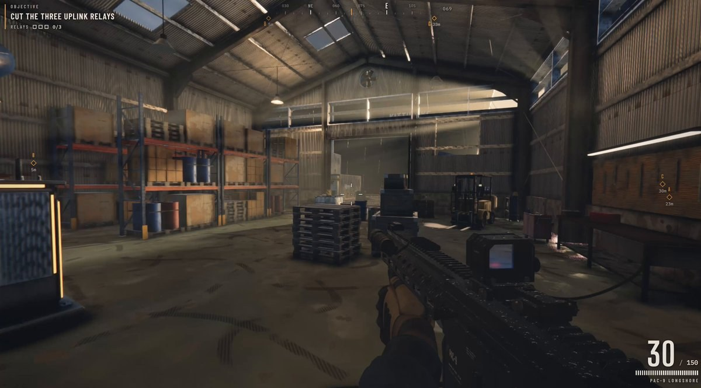
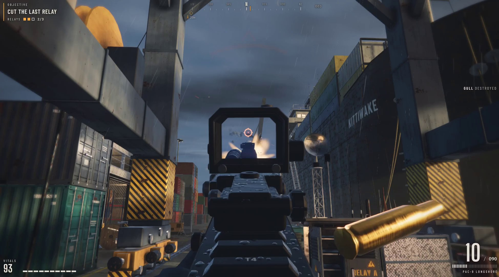
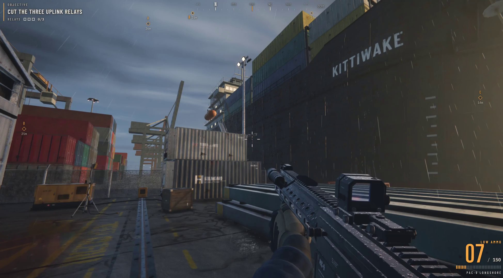
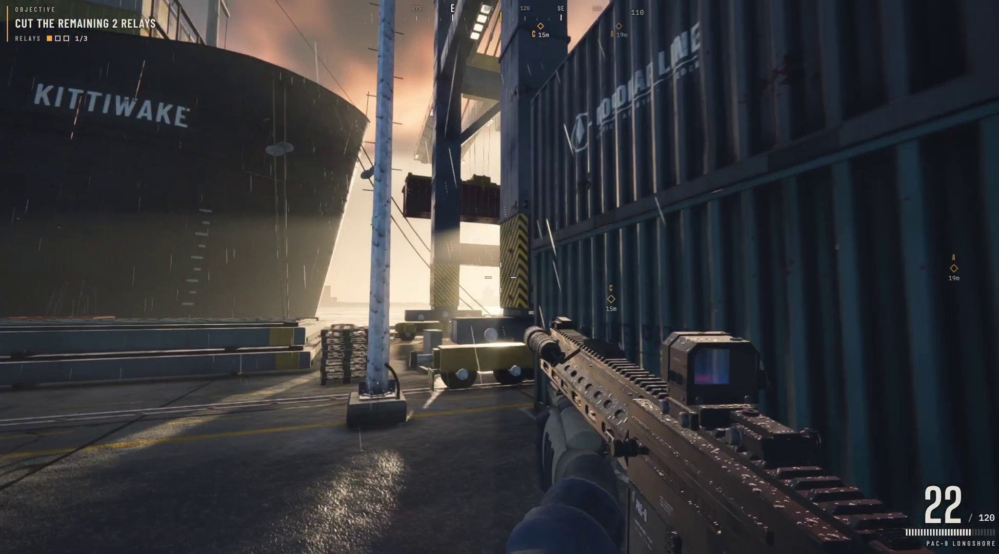

# saltline

非官方衍生合集 · 维护者 [superproxy](https://github.com/superproxy/saltline)

对外只用 **`release/`**：本地静态服务或飞牛安装后，从首页选版本进入游戏。下图与 [release/index.html](release/index.html) 卡片配图一致。

## 画面预览

<table>
  <tr>
    <td align="center"><b>原版</b><br><code>盐线行动SALTLINE-原版.html</code></td>
    <td align="center"><b>中文版</b><br><code>盐线行动SALTLINE-中文魔改版.html</code></td>
    <td align="center"><b>国际版</b><br><code>Saltline-International.html</code></td>
  </tr>
  <tr>
    <td></td>
    <td></td>
    <td></td>
  </tr>
  <tr>
    <td align="center"><b>手机魔改</b><br><code>盐线行动SALTLINE-手机魔改版.html</code></td>
    <td align="center"><b>手机国际</b><br><code>盐线行动SALTLINE-手机国际版.html</code></td>
    <td align="center"><b>NAS 合集</b><br><code>downloads/Saltline.fpk</code></td>
  </tr>
  <tr>
    <td></td>
    <td></td>
    <td></td>
  </tr>
</table>

## `release/` 目录

```
release/
├── index.html                     # 三端合集首页（GitHub / 本地）
├── index-fn-os.html               # 飞牛专用首页（由 build_fnos_www 从 index 生成）
├── gameplay-original.jpg          # 上图配图资源
├── gameplay-63.jpg
├── gameplay-18.jpg
├── gameplay-40.jpg
├── 盐线行动SALTLINE-原版.html
├── 盐线行动SALTLINE-中文魔改版.html    # 设置内可开无限弹药/生命（默认关）
├── Saltline-International.html    # 13 种界面语言
├── 盐线行动SALTLINE-手机魔改版.html
├── 盐线行动SALTLINE-手机国际版.html
└── downloads/
    ├── Saltline.fpk               # 飞牛 NAS 安装包
    ├── Saltline.fpk.sha256
    └── Saltline.port
```

| 场景 | 怎么做 |
| --- | --- |
| 本地试玩 | 见下方「本地预览」，打开首页点卡片 |
| 飞牛 fnOS | 安装 `release/downloads/Saltline.fpk`；应用中心维护者 **superproxy**，项目页 [github.com/superproxy/saltline](https://github.com/superproxy/saltline) |

## 本地预览

不要用 `file://`。在仓库根目录执行：

```bash
cd release && python3 -m http.server 8765
```

浏览器打开 [http://127.0.0.1:8765/](http://127.0.0.1:8765/)。需要 WebGL；语言键 `sl-lang`（与国际版、首页一致）。

## 维护者：`tools/`

游戏 HTML **只维护在 `release/`**。飞牛打包时 `tools/fnos_stage.py` 从 `release/` 原样拷贝进 FPK（`index.html` = `index-fn-os.html`）。`tools/fnos/.../app/www` 不纳入 Git。

```bash
python3 tools/build_intl_edition.py
python3 tools/build_fnos_www.py
python3 tools/fnos/pack_fpk.py   # 更新 release/downloads/Saltline.fpk
```

原作：Felix Rieseberg。本合集为衍生改编，授权状态待核实。